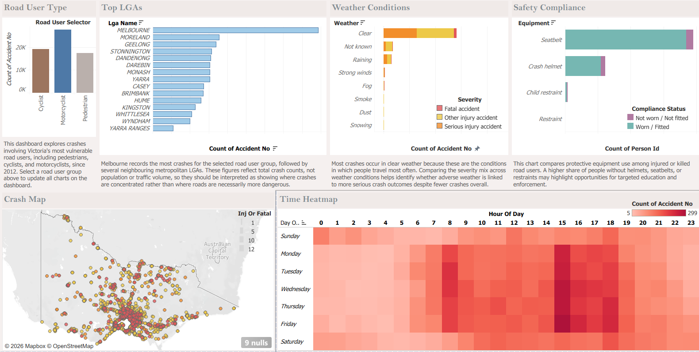

# Victorian Road Crash Analysis | Tableau Dashboard

An interactive data visualisation project examining road crash patterns in Victoria, Australia, using Tableau.

Developed to support the identification and communication of road safety trends, this project demonstrates how visual analytics can help inform evidence-based transport planning and road safety decisions.

## Dashboard Preview



*The dashboard provides a visual overview of selected Victorian road crash data.*

## Project Overview

Road crashes have significant implications for public safety, transport infrastructure, and communities.

This project uses Victorian road crash data to develop a Tableau dashboard designed around a practical transport planning scenario: helping decision-makers investigate crash patterns and identify potential areas of concern.

The dashboard applies principles of information visualisation, data graphics, and cartographic design to communicate information through a coherent visual interface.

### Project Objectives

- Explore Victorian road crash data through visualisation.
- Identify relevant trends and patterns within the selected dataset.
- Present information in an accessible and interpretable dashboard.
- Demonstrate the application of information visualisation and dashboard design principles.
- Support data-informed discussions about road safety.

## Dashboard Features

*To be updated after reviewing the completed Tableau workbook.*

This section will document the actual visualisations, data dimensions, filters, and interactive functionality implemented in the dashboard.

## Key Insights

*To be completed using findings supported by the dashboard.*

This section will summarise the most meaningful observations revealed by the visualisations, including their relevance to road safety decision-making.

## Tools and Technologies

| Technology | Purpose |
|---|---|
| Tableau | Data visualisation and dashboard development |
| Tableau Packaged Workbook (.twbx) | Packaging and distributing the completed dashboard |
| Git & GitHub | Version control, documentation, and project presentation |

## Dataset

**Source:** Victorian road crash dataset provided through the University of Melbourne's GEOM90007 Information Visualisation subject.

**Context:** The dataset was supplied for an assignment based on a hypothetical Transport Victoria road safety analysis scenario.

The analysis uses selected information from the provided road crash dataset.

**Data availability:** Public redistribution of the underlying course-provided dataset is subject to its applicable permissions and licensing conditions.

## Getting Started

### Prerequisites

- Tableau Desktop (a compatible version capable of opening packaged workbooks)

### Instructions

1. Clone the repository:

   `git clone https://github.com/KarthikKannan1/victoria-road-crash-analysis.git`

2. Navigate to the `dashboard` directory.

3. Open `victoria-road-crash-dashboard.twbx` using Tableau Desktop.

4. Explore the dashboard and its available visualisations.

**Note:** The Tableau workbook is stored using Git Large File Storage (Git LFS). If cloning the repository, ensure Git LFS is installed and run `git lfs pull` if the workbook has not downloaded automatically.

## Repository Structure

```text
victoria-road-crash-analysis/
├── dashboard/
│   └── victoria-road-crash-dashboard.twbx
├── screenshots/
│   └── dashboard-overview.png
├── .gitattributes
└── README.md
```

## Design Approach

The dashboard was developed with reference to established information visualisation principles, including:

- Selecting graphical representations appropriate to the underlying data.
- Organising information into a coherent visual narrative.
- Applying visual hierarchy to support readability.
- Considering the interpretation of visual variables such as colour, position, and size.
- Presenting information for an audience familiar with Victorian transport and geographic contexts.

## Limitations and Future Improvements

This dashboard is an exploratory visualisation project rather than a predictive road safety model.

Patterns visible in crash data do not necessarily establish causal relationships.

Potential future improvements include incorporating additional contextual datasets, extending the analysis across different time periods, and enhancing dashboard interactions where appropriate.

## Academic Context

This project was developed as an **individual assessment** for:

**GEOM90007 – Information Visualisation**  
The University of Melbourne  
Semester 2, 2026

The project demonstrates the practical application of information visualisation, dashboard development, and cartographic design principles using Tableau.

## Author

**Karthik Kannan**

[GitHub Profile](https://github.com/KarthikKannan1)
